# V2.8.2 New Feature

## Live Control - End-effector - Robotiq Gripper
Feature Description
* Added speed and force adjustment for the Robotiq-2F-85 and Robotiq-2F-140 grippers.

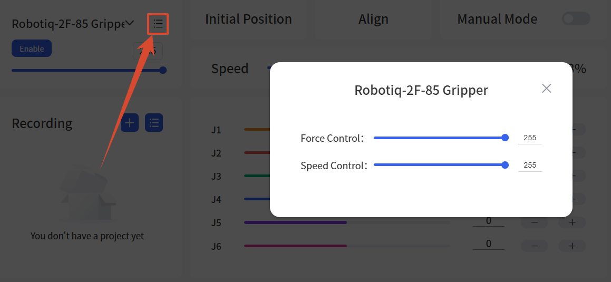

## Live Control - End-effector - Gripper G2 and BIO Gripper G2

Feature Description
* Added drive version and SN display for Gripper G2 and BIO Gripper G2.

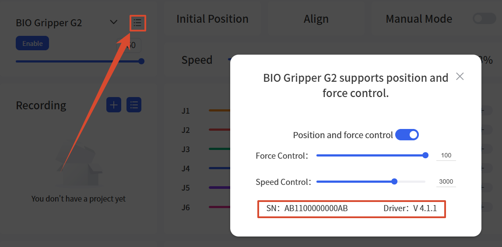

## Live Control - End-effector Models - Six-Axis Force-Torque Sensor (AI1500)
Feature Description
* Added the Six-Axis Force-Torque Sensor (AI1500).

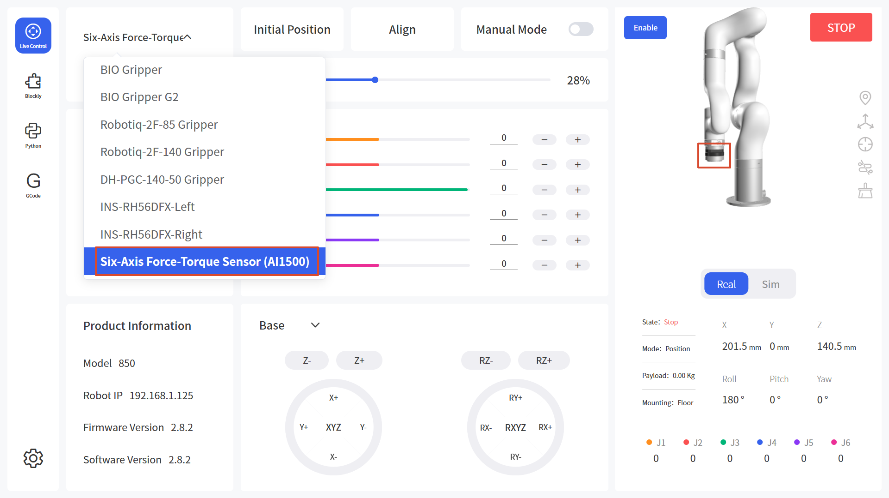

## Live Control - End-effector - Grippers (Excluding Robotiq)
Feature Description
* Supports 3D visualization of gripper opening/closing. (Enable "Environment Simulation(Beta)" first, then enable "Simulated Gripping" in the "3D Scene".)

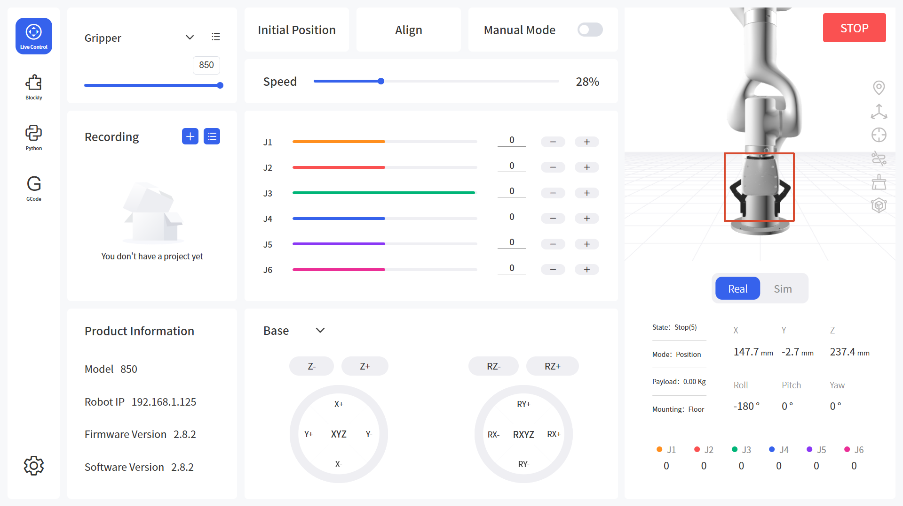

Steps to Enable:
1. In Settings - General - Assistive Features, enable the "Environment Simulation(Beta)" option (this feature is still in testing), then open the "3D Scene".

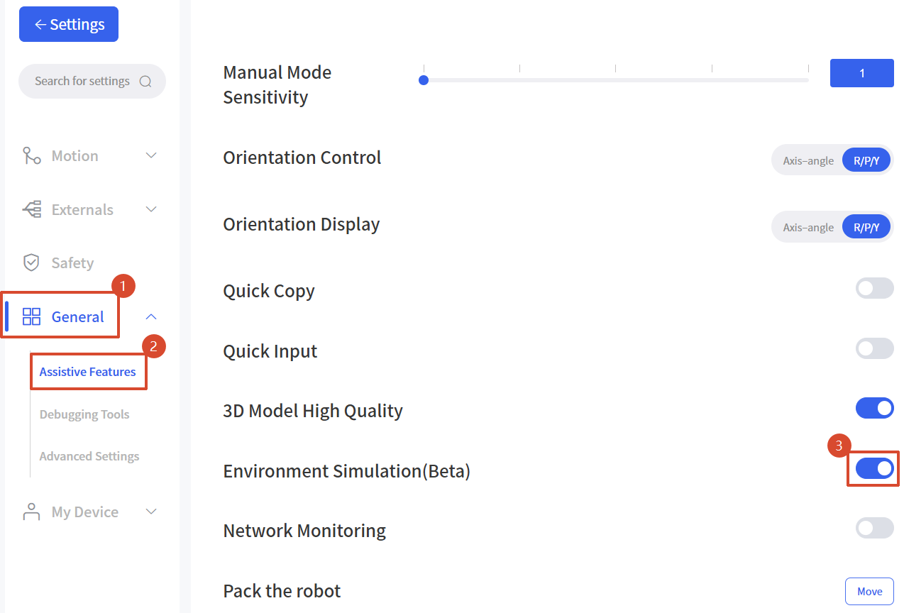

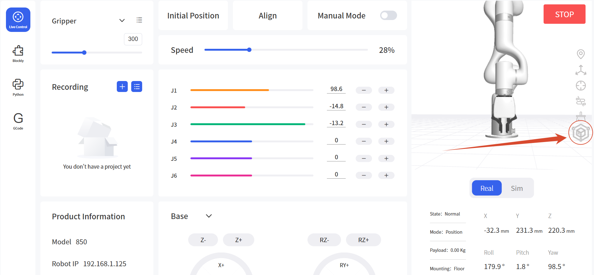

2. Enable "Simulated Gripping".

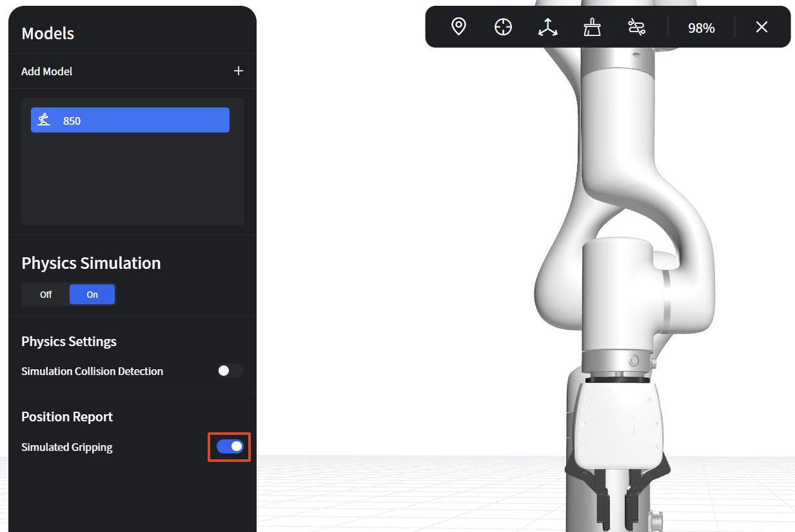

## Live Control - 3D Scene
Feature Description
* Added the "Simulation Collision Detection" toggle and the corresponding functionality.

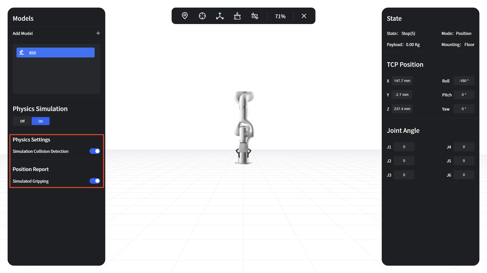

## Live Control - Recording - Import Trajectory
Feature Description
* Trajectory file import now supports the .traj format.

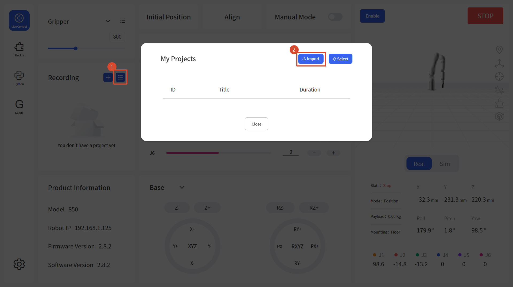

## Blockly - Tool
Feature Description
* Added a code block to get the gripper position.
    * Options: Gripper, Gripper G2, BIO Gripper G2, Robotiq Gripper.

Example: close/open the gripper and print the position.

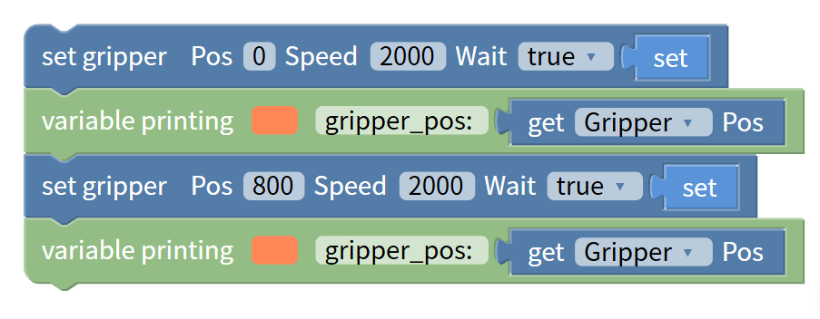

## Blockly - Externals
Feature Description
* Added data-parsing options to the "get holding register address" block. Data Type: HEX / INT 16 (DEC) / UINT 16 (DEC).
    * HEX: Outputs the raw register data in hexadecimal, 2 bytes, e.g. FF FE.
    * INT 16 (DEC): Parses as a signed 16-bit integer, range -32768 to 32767, e.g. FF FE is displayed as -2.
    * UINT 16 (DEC): Parses as an unsigned 16-bit integer, range 0 to 65535, e.g. FF FE is displayed as 65534.

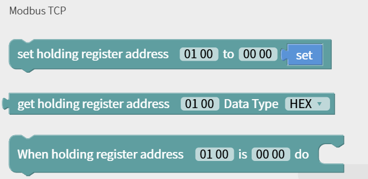

## Python IDE - BlocklyToPython Folder
Feature Description
* Allows downloading files under the BlocklyToPython folder.

## GCode - Sample Files/Folders
Feature Description
* Added the download function for sample files/folders.

## Settings - Motion - TCP
Feature Description
* Added TCP payload and offset parameters for the Six-Axis Force-Torque Sensor (AI1500).

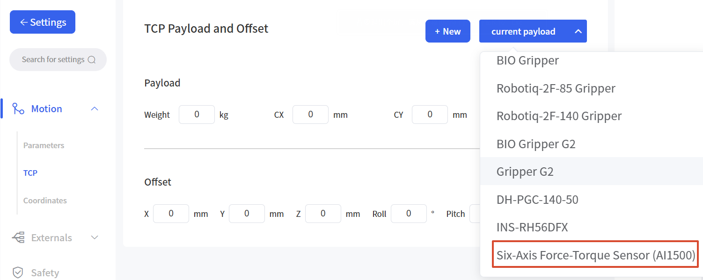

## Settings - General - Advanced Settings
Feature Description
* Added an entry to modify the joint servo mode linear velocity threshold.
    * Sets the factor for the TCP speed limit in joint servo mode. The default is 1.2.
    * Actual limit = factor × the maximum TCP speed of the robotic arm.
    * xArm series/UF850: 1.2 × 1000 = 1200mm/s.
    * Lite6: 1.2 × 500 = 600mm/s.

For safety reasons, a TCP linear velocity limit is applied in ServoJ mode even for joint motion. When the arm works at extended reach, the TCP linear velocity can easily exceed this threshold and trigger the C60 error. The factor can be increased carefully after a safety evaluation.

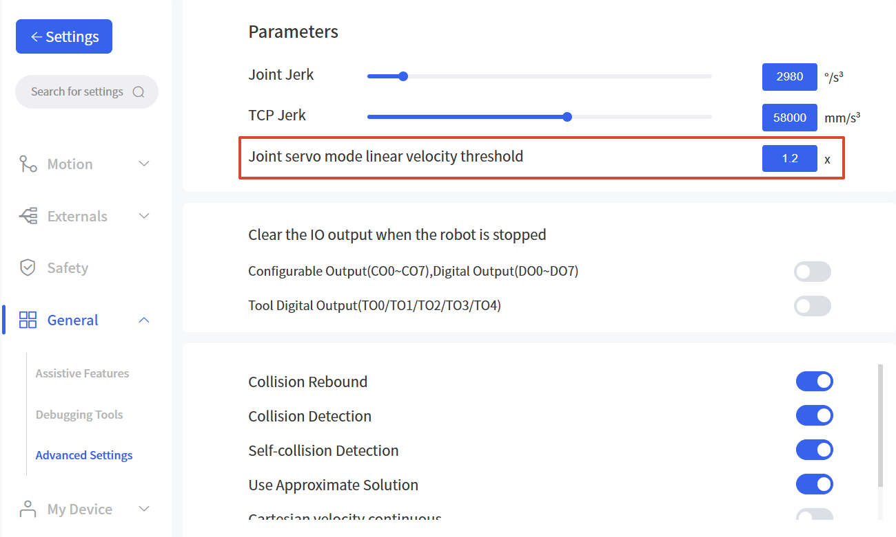

## Settings - Externals - Torque Sensor
Feature Description
* Added the "Manual Mode Starting Force and Torque" settings.
    * Used to set the starting force and torque thresholds for each axis when using torque-based manual mode with the six-axis force-torque sensor.

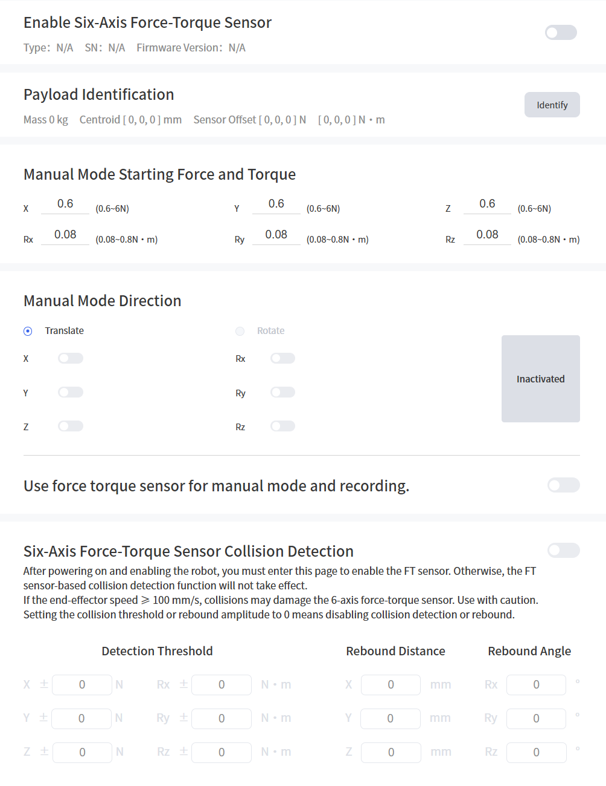

## Settings - General - Assistive Features
Feature Description
* The "Use high refresh rate 3D model" and "Use high-resolution 3D model" options are merged into "3D Model High Quality".

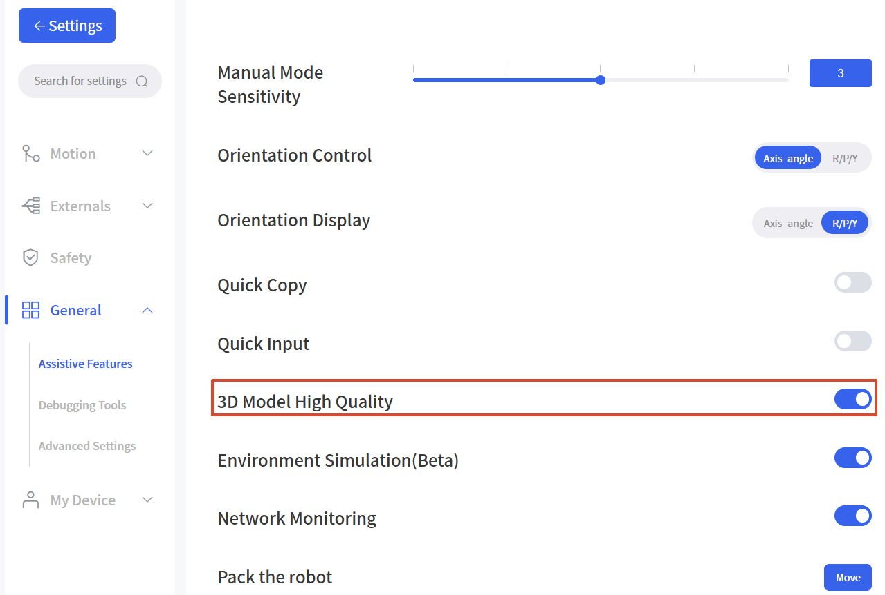
