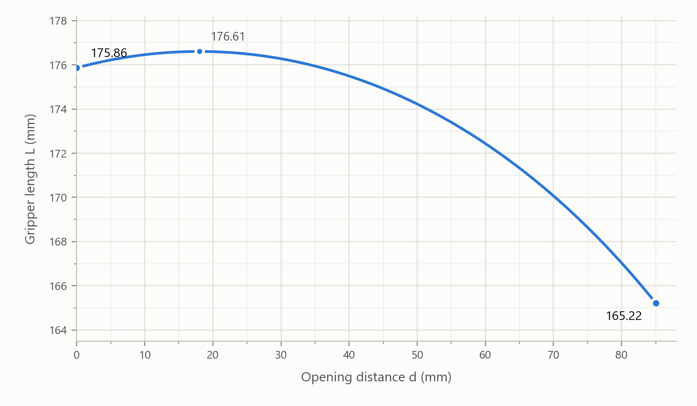

# 6. Technical Specifications

## 6.1 Specifications

| Gripper G2 (AG1200) |                     |
| ------------------- | ------------------- |
| Rated Supply Voltage       | 24V DC 1.5A Max     |
| Absolute Maximum Supply Voltage   | 28V DC              |
| Minimum power consumption          | 1W                  |
| Gripper Weight              | 820g                |
| Payload   | 5kg                 |
| Stroke              | 84±1mm              |
| Finger Type         | Replaceable         |
| Gripping Force      | 10-50N              |
| Rated Torque              | 0.22 N·m            |
| Peak Torque               | 0.5 N·m             |
| Torque Constant Kt        | 0.09 N·m/A          |
| Closing Speed | 15-225mm/s        |
| Cycle Life          | >2,000,000 cycles   |
| Communication | RS-485, Modbus RTU  |
| Programmable Parameters | Speed, Position, Torque |
| Feedback            | Position            |
| Protection Rating   | IP40                |
| Operating Temperature | 0-50℃             |

## 6.2 Mechanical Dimensions

The mechanical dimensions of the Gripper G2 are shown below, where d is the opening distance between the two fingers and L is the gripper length.

Dimensions in the closed position:

Dimensions in the open position and side view:

Bottom mounting dimensions:

The gripper length L varies with the opening distance d according to the geometric relationship:

$$L = 121.606 + \sqrt{55.000^2 - (0.5d - 8.997)^2}$$

where L and d are in mm. For example, L ≈ 175.86 mm at d = 0 and L ≈ 165.22 mm at d = 85 mm, which agree with the dimensions marked in the figures above.

The curve of L versus d is shown below:

