# V2.8.2新功能

## 实时控制-末端执行器-Robotiq机械爪
功能说明
* 新增Robotiq-2F-85、Robotiq-2F-140机械爪的速度和力调节。

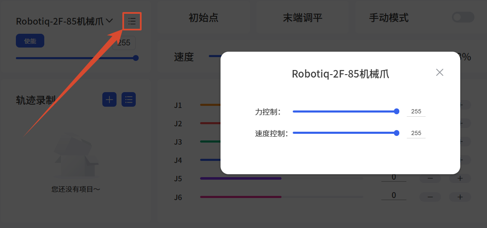

## 实时控制-末端执行器-机械爪 G2和BIO 机械爪 G2

功能说明
* 新增机械爪 G2、BIO 机械爪 G2 的驱动版本和SN显示。

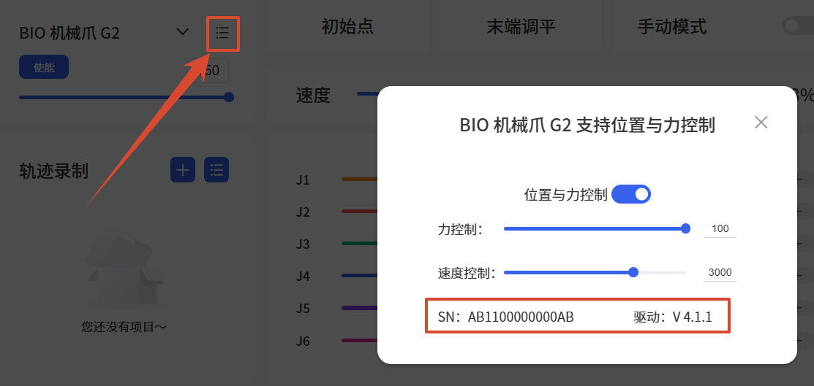

## 实时控制-末端执行器模型-六维力矩传感器(AI1500)
功能说明
* 新增六维力矩传感器(AI1500)。

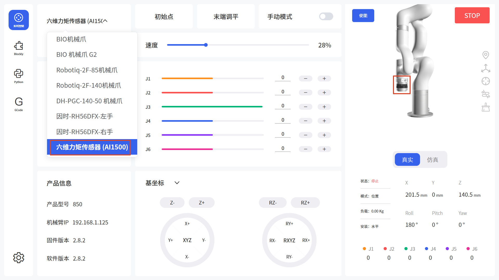

## 实时控制-末端执行器-机械爪(不含Robotiq)
功能说明
* 支持3D显示机械爪开合。（需先开启“环境仿真(Beta)”，然后在“3D场景”中开启“仿真夹取”功能）

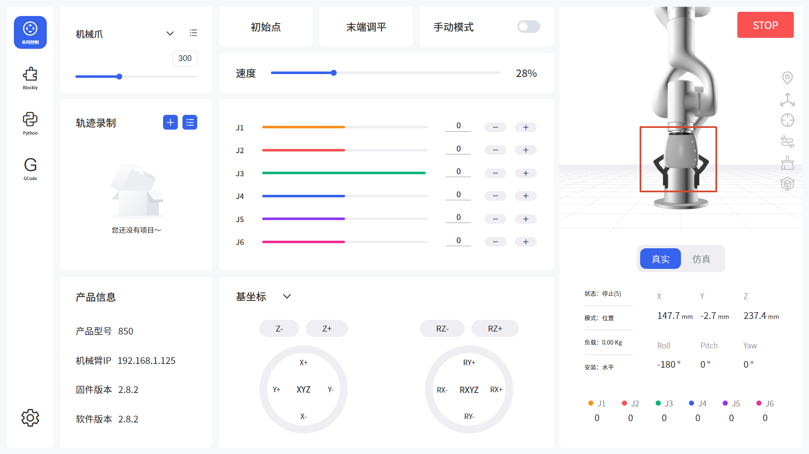

开启步骤：
1. 在通用设置-辅助功能中，打开“环境仿真(Beta)”选项（此功能还在测试中），然后进入“3D场景”。

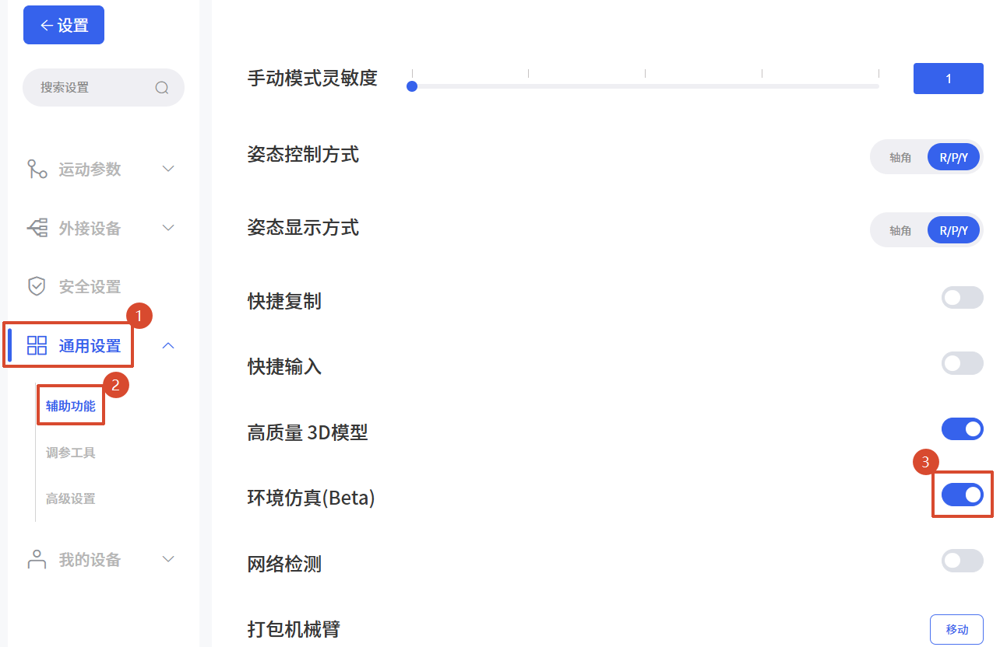

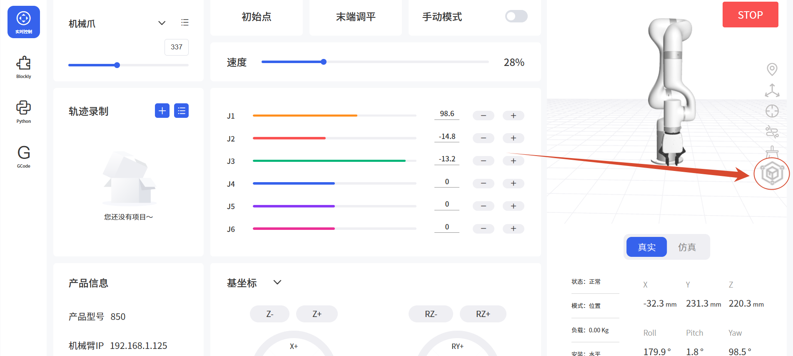

2. 开启“仿真夹取”。

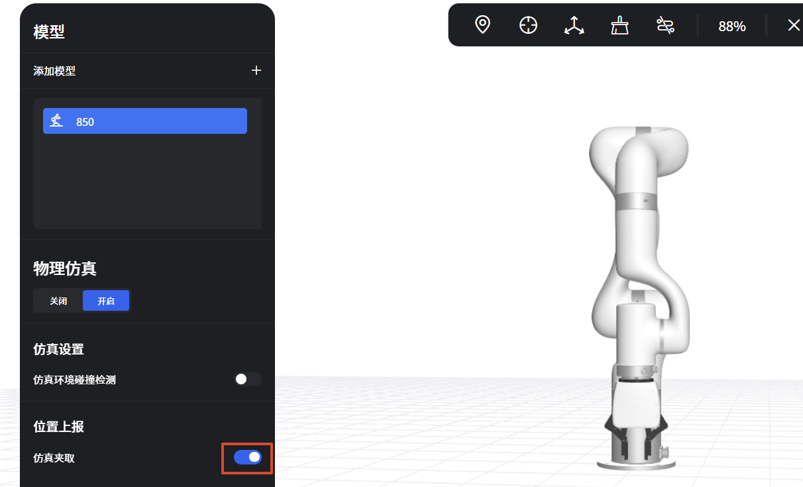

## 实时控制-3D场景
功能说明
* 增加“仿真环境碰撞检测”的开关和对应的功能。

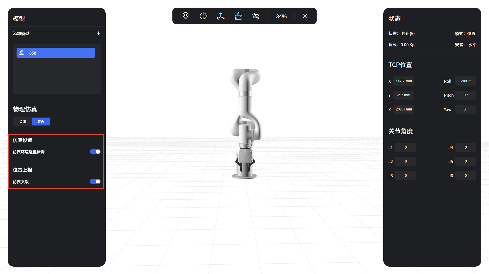

## 实时控制-轨迹录制-导入轨迹
功能说明
* 导入轨迹文件支持 .traj 格式。

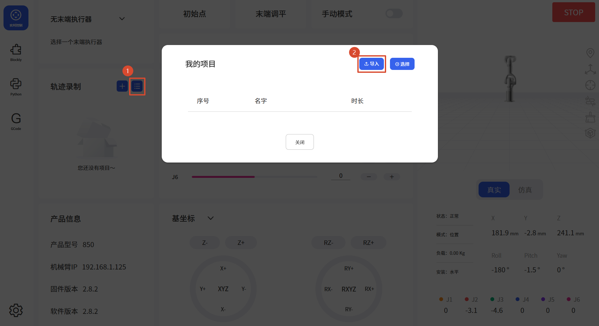

## Blockly-末端工具
功能说明
* 增加获取机械爪位置的代码块。
    * 可选：机械爪、机械爪 G2、BIO 机械爪 G2、Robotiq机械爪。

示例：闭合/打开机械爪，并打印位置。

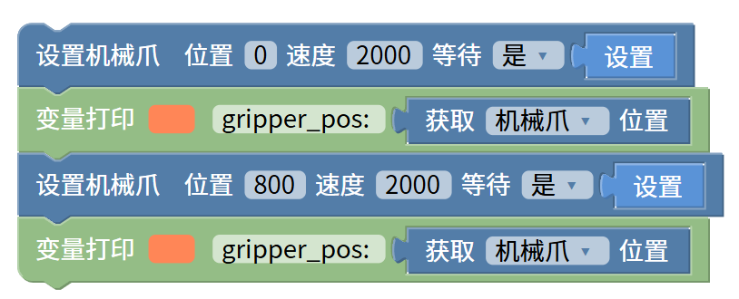

## Blockly-外接设备
功能说明
* 获取“保持寄存器地址”增加数据解析的选项，数据类型：HEX/INT 16(DEC)/UINT 16(DEC)。
    * HEX：按十六进制输出寄存器原始数据，2字节，如 FF FE。
    * INT 16(DEC)：按有符号16位整数解析，范围-32768~32767，如 FF FE 显示为 -2。
    * UINT 16(DEC)：按无符号16位整数解析，范围0~65535，如 FF FE 显示为 65534。

## Python IDE-BlocklyToPython文件夹
功能说明
* 允许下载BlocklyToPython文件夹下的文件。

## GCode-示例文件/文件夹
功能说明
* 增加示例文件/文件夹的下载功能。

## 设置-运动参数-TCP设置
功能说明
* 新增六维力矩传感器(AI1500)的TCP 负载与偏移参数。

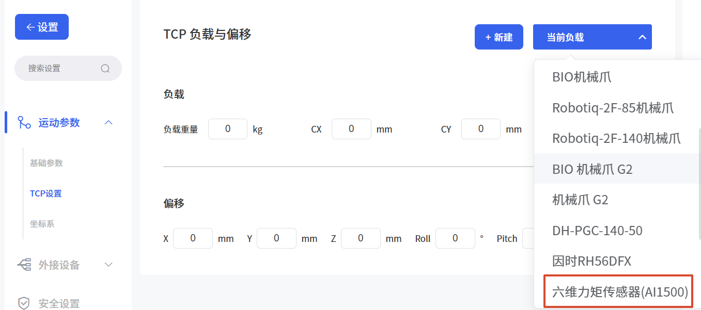

## 设置-通用设置-高级设置
功能说明
* 增加关节伺服模式线速度阈值修改入口。
    * 设置关节伺服模式下TCP速度限制的倍数，默认为1.2。
    * 实际限制值 = 倍数 × 机械臂的最大TCP速度。
    * xArm系列/UF850：1.2 × 1000 = 1200mm/s。
    * Lite6：1.2 × 500 = 600mm/s。

出于安全考虑，即使是关节运动，伺服模式也会限制TCP速度；机械臂伸展工作时TCP速度容易超出该限制并报C60错误，可在安全评估后谨慎调大该倍数。

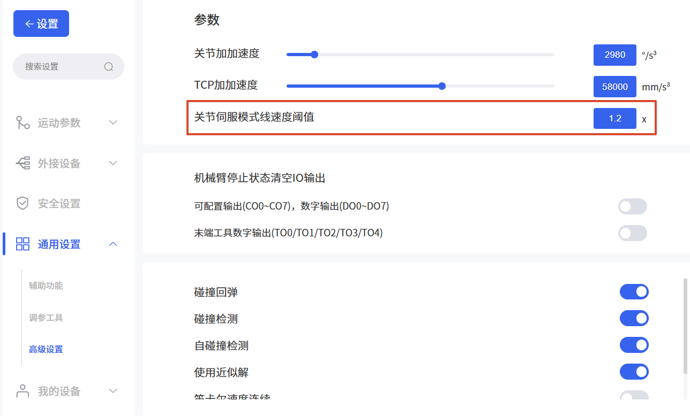

## 设置-外接设备-力矩传感器
功能说明
* 增加手动模式启动力与力矩的设置项。
    * 用于设置配合六维力矩传感器使用手动模式时的各轴启动阈值。

## 设置-通用设置-辅助功能
功能说明
* 使用高精细3D模型与使用高刷新率3D模型选项合并为高质量3D模型。

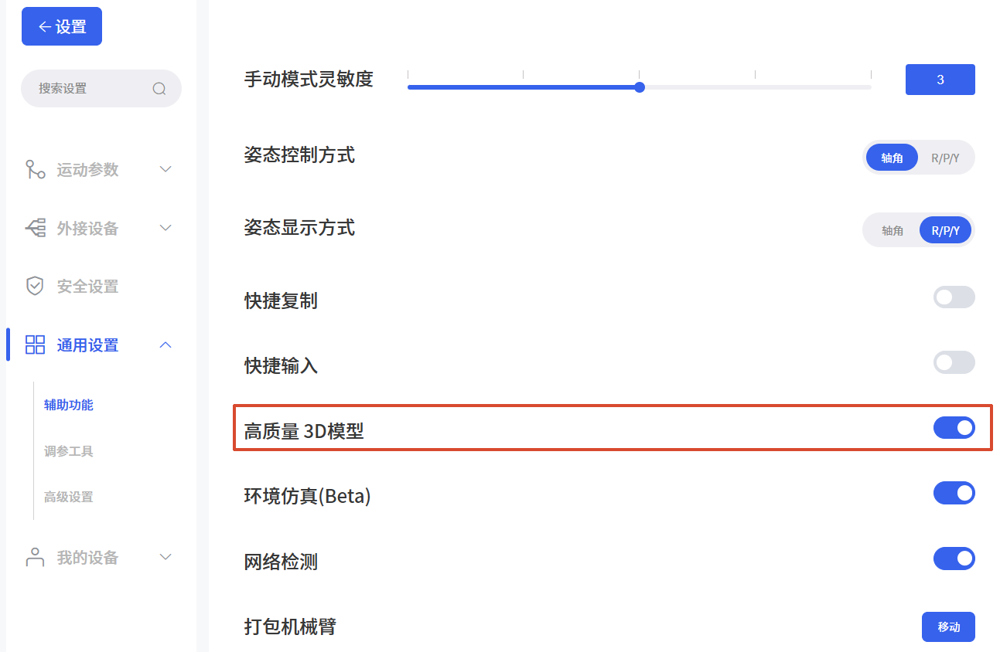
