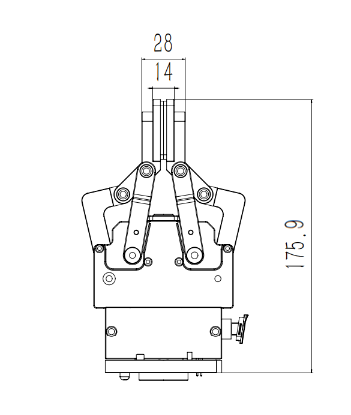
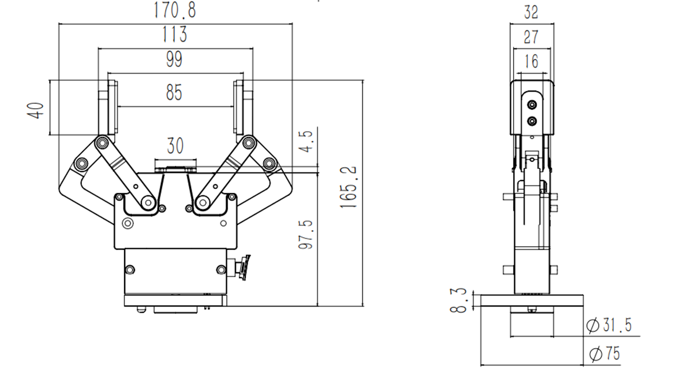
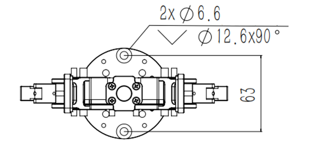
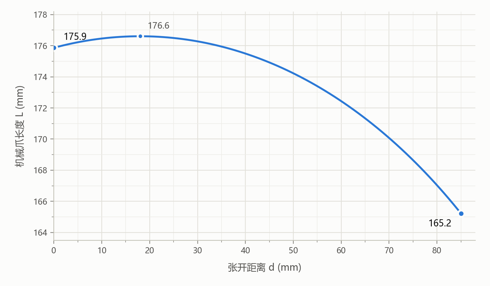

# 6.技术规格

## 6.1 技术参数

| 机械爪G2（AG1200） |                    |
| ------------- | ------------------ |
| 额定电压          | 24V DC 1.5AMax     |
| 最大输入电压        | 28V DC             |
| 静态功耗（最低功耗）    | 1W                 |
| 重量            | 820g               |
| 负载            | 5kg                |
| 行程            | 84±1mm             |
| 手指形态          | 可更换                |
| 夹持力           | 10-50N             |
| 额定扭矩          | 0.22 N·m           |
| 峰值扭矩          | 0.5 N·m            |
| 扭矩常数Kt        | 0.09 N·m/A         |
| 开合速度          | 15-225mm/s         |
| 寿命            | ＞2,000,000循环       |
| 通信协议          | RS-485, Modbus RTU |
| 可编程参数         | 速度、位置、力矩           |
| 反馈            | 位置                 |
| 防护等级          | IP40               |
| 使用环境          | 0-50℃              |

## 6.2 机械尺寸

机械爪G2的机械尺寸如下图所示。图中 d 为两指张开距离，L 为机械爪长度。

闭合状态下的尺寸：

张开状态下的尺寸及侧视图：

底部安装尺寸：

机械爪长度 L 与张开距离 d 的几何关系为：

$$L = 121.606 + \sqrt{55.000^2 - (0.5d - 8.997)^2}$$

式中，L 和 d 的单位均为 mm。例如，d = 0 时 L ≈ 175.9 mm，d = 85 mm 时 L ≈ 165.2 mm，与上图中闭合、张开状态的尺寸标注一致。

L 随 d 变化的曲线如下图所示：

